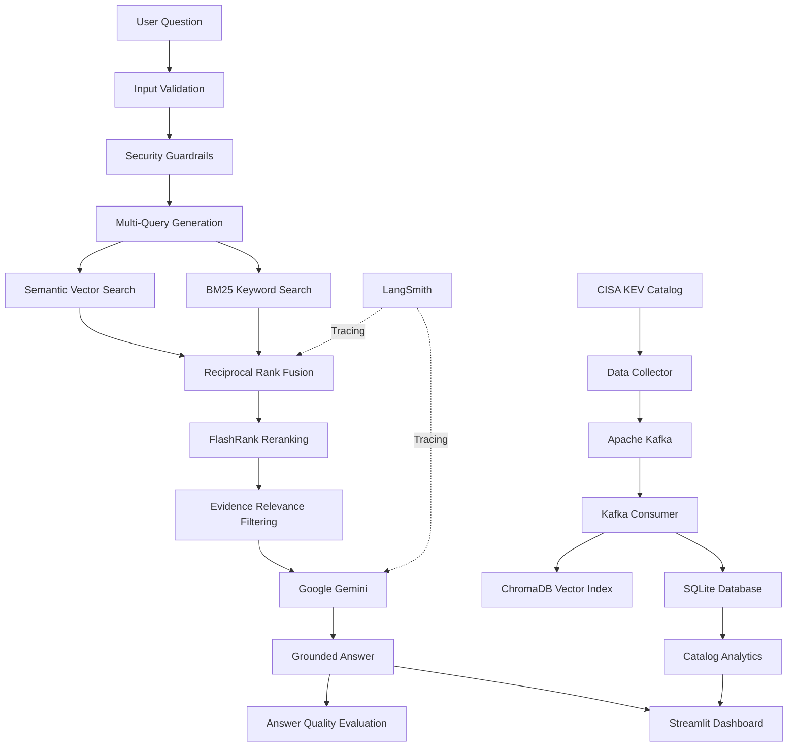

# 🛡️ CyberStream RAG
### Real-Time Cybersecurity Threat Intelligence Platform

An end-to-end Retrieval-Augmented Generation (RAG) platform that transforms CISA Known Exploited Vulnerabilities (KEV) data into an intelligent cybersecurity threat investigation assistant.

CyberStream RAG combines hybrid information retrieval, semantic search, keyword search, Reciprocal Rank Fusion (RRF), FlashRank reranking, and Google Gemini to deliver evidence-grounded answers about known exploited vulnerabilities.

**[🚀 Live Application](https://cyberstream-rag-byjzdvonf5jypmv4qutkbz.streamlit.app/) | [📂 GitHub Repository](https://github.com/Mainuddin123/CyberStream-RAG)**

---

## 📌 Project Overview

Security teams need reliable ways to investigate vulnerabilities, identify affected products, and understand known security threats.

Traditional keyword-based search can miss relevant information, while standalone LLMs may generate unsupported cybersecurity claims.

CyberStream RAG addresses these challenges through a hybrid retrieval architecture that retrieves vulnerability evidence from the CISA KEV catalog before generating answers.

The platform provides:

- Product and vendor-specific vulnerability investigation.
- Exact CVE identifier lookup.
- Evidence-grounded AI-generated responses.
- Multi-product vulnerability comparison.
- Catalog-wide vulnerability analytics.
- Security guardrails against prompt injection and unsupported answers.

## 🏗️ System Architecture



## ⚙️ Technology Stack

| Category | Technologies |
|---|---|
| Programming Language | Python |
| Frontend | Streamlit |
| Data Source | CISA KEV Catalog |
| Data Streaming | Apache Kafka |
| Database | SQLite |
| Vector Database | ChromaDB |
| Embeddings | Sentence Transformers – all-MiniLM-L6-v2 |
| Semantic Retrieval | Vector Similarity Search |
| Keyword Retrieval | BM25 |
| Ranking | Reciprocal Rank Fusion (RRF) |
| Reranking | FlashRank |
| LLM | Google Gemini API |
| Observability | LangSmith |
| Analytics | Pandas, Streamlit Charts |
| Deployment | Streamlit Community Cloud |
| Version Control | Git and GitHub |

## 🔍 Core Features

### 1. Real-Time Threat Intelligence Ingestion

- Collects vulnerability information from the official CISA Known Exploited Vulnerabilities catalog.
- Uses Apache Kafka for event-based data ingestion and processing.
- Stores structured vulnerability records in SQLite.
- Maintains a searchable vector index using ChromaDB.

### 2. Advanced Hybrid Retrieval

Combines multiple retrieval techniques to improve the relevance of cybersecurity evidence.

**Semantic Search**

Uses Sentence Transformers to generate dense vector embeddings and identify semantically similar vulnerability records.

**BM25 Keyword Search**

Retrieves records based on important keywords, product names, vendor names, and technical terminology.

**Reciprocal Rank Fusion (RRF)**

Combines rankings from multiple retrieval methods.

Formula:

\[
RRF(d)=\sum_{r \in R}\frac{1}{k+rank_r(d)}
\]

Where:

- \(d\) = retrieved document
- \(R\) = retrieval result lists
- \(k\) = ranking constant
- \(rank_r(d)\) = document rank in retrieval list \(r\)

**FlashRank Reranking**

Reorders retrieved candidates to prioritize the most relevant vulnerability evidence.

### 3. Retrieval-Augmented Generation

- Retrieves relevant CISA vulnerability records.
- Constructs an evidence-based context.
- Uses Google Gemini to generate answers.
- Provides model fallback when the primary generation model fails.
- Avoids unsupported vulnerability claims by grounding answers in retrieved evidence.

### 4. Security Guardrails

Implements multiple protective mechanisms:

- Input validation.
- Question length restrictions.
- Prompt-injection detection.
- Product and vendor relevance filtering.
- Multiple-product evidence filtering.
- Exact CVE identifier filtering.
- Unknown CVE handling.
- Evidence-only fallback when generation fails.

### 5. Catalog-Wide Vulnerability Analytics

Provides an analytical view of the indexed vulnerability catalog.

- Total vulnerability record count.
- Automated vulnerability category classification.
- Vulnerability category distribution.
- Category-wise record counts.
- Percentage-based breakdown.
- Interactive analytics visualization.

Classification uses keyword-based rules applied to vulnerability names and descriptions. These are estimated categories, not official CISA classifications. A vulnerability may belong to multiple categories.

### 6. Answer Quality Evaluation

Evaluates generated responses using:

- Citation correctness.
- Citation validation.
- Retrieved evidence.
- Answer-quality evaluation results.

### 7. Observability with LangSmith

Uses LangSmith tracing to monitor important RAG operations, including retrieval and LLM generation.

---

## 📊 Project Implementation Results

| Metric | Result |
|---|---:|
| CISA vulnerability records processed | 1,766 |
| SQLite records | 1,766 |
| ChromaDB indexed records | 1,766 |
| Automated guardrail tests passed | 17/17 |
| Multiple-product retrieval | Tested |
| Exact CVE retrieval | Tested |
| Unknown CVE handling | Tested |
| Prompt-injection protection | Tested |

*Record counts represent the tested catalog snapshot and may change as CISA updates its catalog.*

## 🖥️ Application Screenshots

### Threat Investigation Dashboard

The Streamlit interface enables users to investigate cybersecurity threats using natural-language questions.

### Hybrid Retrieval and Evidence-Grounded Answers

Displays generated answers alongside retrieved vulnerability records and CVE identifiers.

### CISA Catalog Analytics

Visualizes vulnerability category distributions and catalog-wide statistics.

## 🚀 Getting Started

### Prerequisites

- Python 3.11 or later.
- Git.
- Docker Desktop (for the local Kafka pipeline).
- Google Gemini API key.
- LangSmith API key (optional, for tracing).

### 1. Clone the repository

```bash
git clone https://github.com/Mainuddin123/CyberStream-RAG.git

cd CyberStream-RAG
```

### 2. Create a virtual environment

```bash
python -m venv .venv
```

Activate on Windows:

```powershell
.venv\Scripts\Activate.ps1
```

### 3. Install dependencies

```bash
python -m pip install -r requirements.txt
```

### 4. Configure environment variables

Create a `.env` file in the project root:

```env
GEMINI_API_KEY=your_gemini_api_key
LANGSMITH_API_KEY=your_langsmith_api_key
LANGSMITH_TRACING=true
LANGSMITH_PROJECT=CyberStream-RAG
```

Never commit API keys or `.env` files to GitHub.

### 5. Start the local Kafka infrastructure

```bash
docker compose up -d --build
```

### 6. Collect and publish vulnerability records

```bash
docker exec cyberstream-app python -m src.producer
```

### 7. Consume and store vulnerability records

```bash
docker exec cyberstream-app python -m src.consumer
```

### 8. Build the vector index

```bash
docker exec cyberstream-app python -m src.indexer
```

### 9. Run the Streamlit application

For local execution:

```bash
python -m streamlit run app.py
```

Open:

```text
http://localhost:8501
```

**Note:** Streamlit Community Cloud initializes its own knowledge base. The local Kafka infrastructure is not required for the cloud-hosted search interface.

---

## 📁 Project Structure

```text
CyberStream-RAG/
│
├── app.py
│
├── src/
│   ├── __init__.py
│   ├── collector.py
│   ├── producer.py
│   ├── consumer.py
│   ├── storage.py
│   ├── indexer.py
│   ├── search.py
│   ├── rag.py
│   ├── cloud_setup.py
│   ├── catalog_analytics.py
│   └── answer_evaluator.py
│
├── tests/
│   └── test_guardrails.py
│
├── data/
│   ├── threats.json
│   ├── threats.db
│   └── chroma/
│
├── .streamlit/
├── Dockerfile
├── docker-compose.yml
├── requirements.txt
├── requirements-dev.txt
├── .gitignore
└── README.md
```

*Generated databases, vector indexes, and other runtime data may be excluded from version control.*

## 🧪 Testing

Run the automated guardrail tests:

```bash
python -m pytest tests/test_guardrails.py -v
```

Verify Python syntax:

```bash
python -m compileall -q app.py src
```

Check installed dependencies:

```bash
python -m pip check
```

## 🔐 Security Considerations

- API keys are stored in environment variables or Streamlit Cloud Secrets.
- User input is validated before processing.
- Common prompt-injection patterns are detected.
- Retrieved documents are treated as untrusted context.
- Generated answers are instructed to use supplied evidence only.
- Unknown CVEs are not presented as verified vulnerabilities.
- Security findings should always be validated against official advisories.

## ⚠️ Limitations

- The knowledge base depends on the availability and freshness of the CISA KEV catalog.
- Semantic retrieval can return imperfect matches.
- Keyword-based classification is an approximation and does not replace expert vulnerability classification.
- LLM responses may still require manual verification.
- The application is an educational and research prototype, not a replacement for professional vulnerability management or security operations platforms.

## 🔮 Future Scope

Potential future extensions include:

- Automated scheduled CISA catalog synchronization.
- More advanced retrieval evaluation.
- Role-based access control.
- Vulnerability severity and risk prioritization.
- Integration with additional threat intelligence sources.
- Production-grade monitoring and deployment infrastructure.

## 👨‍💻 Author

**Khaja Mainuddin**

B.Tech – Artificial Intelligence and Data Science

- GitHub: https://github.com/Mainuddin123
- LinkedIn: https://www.linkedin.com/in/khaja-mainuddin-sk-958436348

## 📜 Disclaimer

CyberStream RAG is an independent educational and research project. It uses publicly available vulnerability information from CISA. It is not affiliated with or endorsed by CISA.

Always verify vulnerability information using official advisories before making security decisions.

---

⭐ If you find this project useful, consider starring the repository.
